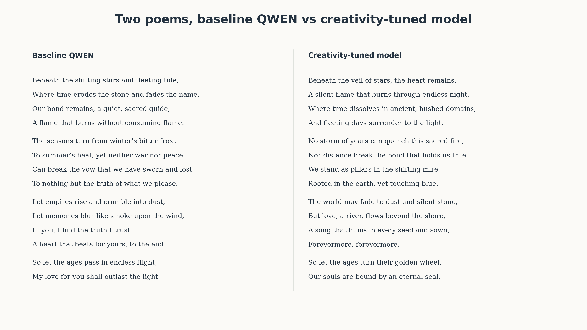
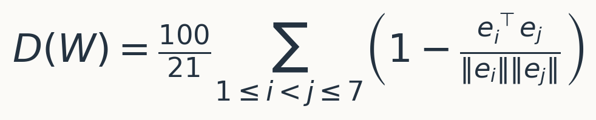
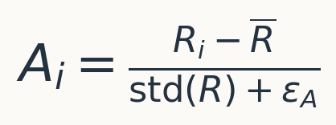
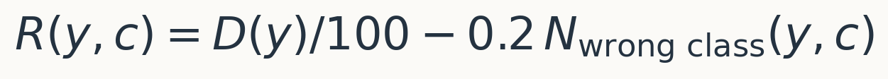
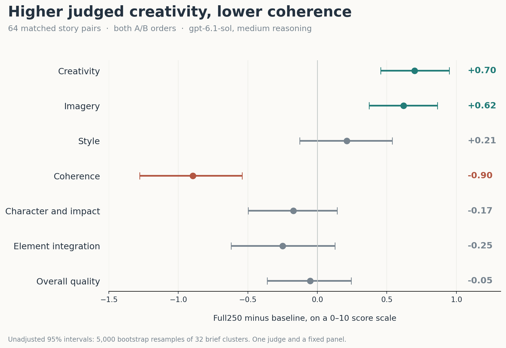

**TLDR:** I've used the simple psychology creativity metric (DAT) as a reward function for LLM finetuning. After few iterations I found a working setup that significantly raised LLM "creativity" as measured by the same metric, by LLM-as-a-judge and human eval (my own). It seems that creativity can be induced in the model.  The weights are open: you can [try the model live](https://huggingface.co/spaces/crazyleg11/full250-creativity),
[download safetensors](https://huggingface.co/crazyleg11/qwen3.8-27b-dat-grpo-full250), or [use a GGUF quantization](https://huggingface.co/crazyleg11/qwen3.8-27b-dat-grpo-full250-GGUF).

# Creativity metric

LLM models have dramatically improved on the tasks with tangible outcomes, but became quite worse on the writing style, clarity and generally became more narrow-minded. AI slop is easily detected. Lot's of people share this narrative and even YC call for startup explicitly claimed "LLMs that write better" as a startup theme. YC: [“LLMs That Write Well”](https://www.ycombinator.com/rfs).

I am on personal quest to explore and (hopefully) fix this. Problem is quite obvious - if we can measure the "style", "clarity" and "creativity" - we can easily align LLMs with the desired outcomes via RL. This is oversimplified of course, but the general idea holds. 

In [my previous post](https://crazylog.substack.com/p/llms-fall-behind-humans-on-creativity), I explored creativity tests from human psychology and applied them to LLMs. The models in that comparison scored below the human reference on the Divergent Association Task, or DAT. 

[DAT was developed by Jay Olson and colleagues](https://doi.org/10.1073/pnas.2022340118). The task is simple: produce ten nouns that are as different from one another as possible. The score measures their average pairwise distance in a fixed word-embedding space. Its authors describe it as a measure of verbal divergent thinking, which is [one part of creativity](https://www.datcreativity.com/faq).

The official implementation scores the **first seven valid, unique words** using GloVe 840B, 300-dimensional embeddings. For those seven vectors, the score is:

## Benchmaxxing creativity

If we have a metric - we can easily convert it to a loss function and RL the model against it. Formally, GRPO reward is (where Ri are rollouts): 

Responses above the group mean receive positive advantages; those below it receive negative advantages. Even a positive absolute reward can have a negative advantage. The update favors the relatively better responses, with clipping and a penalty for drifting from the reference policy.

I will skip several failed attempts. The final recipe compared here used two tasks, DAT with **nouns and verbs** and 28 prompts (rewordings of the DAT task). Adjective-DAT task was used as a hold-out problem for training monitoring and final eval.

Also, I addeda penalty for words that did not satisfy the requested class. This helped a lot and the final reward was:

The [repository](https://github.com/crazyleg/dat-grpo-creativity) contains that scorer, prompt templates and the training code.

## Creativity evaluations

Training on DAT and then measuring DAT would be benchmaxxing. The more interesting question is whether DAT maximization training changes a different task: real creative writing.

I've found few creative benchmarks and tested the new model:

| Evaluation                                                     |             Per model | Purpose                                   | Generation settings                            |
| -------------------------------------------------------------- | --------------------: | ----------------------------------------- | ---------------------------------------------- |
| [Mazur creative writing](https://github.com/lechmazur/writing) | 32 briefs × 2 samples | Stories integrating ten required elements | Temperature 1.0; top-p 1.0; top-k unrestricted |
| [WritingBench](https://github.com/X-PLUG/WritingBench)         |            64 prompts | Writing quality and style                 | Temperature 0.7; top-p 0.8; top-k 20           |
| [SteerBench](https://github.com/MLD3/steerability)             |             128 edits | Following requested style changes         | Greedy decoding                                |

The overall read of results was absolutely non-impressive and showed no gains. 

![[initial-writing-evaluations.png]]

Important to understand how those metrics work - WritingBench prompts LLMs to write some short stories and judges them by it's own fine-tuned critic - small 8B model. It wasn't able to detect any changes.

SteerBench is deterministic metric on the style/rewrite using set of rules and Mazur bench (also short stories generation) - we did a quite LLM-as-a-judge eval with recommended Phi4 small model. 

But, when I read those stories - something didn't felt right. The full finetune (Full250) model as produced a notably different writing style, more diverse, deeper analogies and more imaginative overall. 

To make sure I am not biased here I re-scored the generated stories in A/B + B/A test (to avoid positional bias) with a much more capable model - 6.1 Sol and asked to generate a set of scores for different creativity aspects with guided decoding.
### A second judge with separate dimensions

| Metric, 0–10         | Baseline | Full250 | Change | Paired 95% interval | Full250 win credit |
| -------------------- | -------: | ------: | -----: | ------------------- | -----------------: |
| Creativity           |     5.22 |    5.92 |  +0.70 | [+0.46, +0.95]      |             74.22% |
| Imagery              |     5.59 |    6.21 |  +0.62 | [+0.37, +0.86]      |             72.66% |
| Style                |     4.64 |    4.85 |  +0.21 | [-0.13, +0.54]      |             56.64% |
| Coherence            |     5.19 |    4.30 |  -0.90 | [-1.28, -0.54]      |             32.03% |
| Character and impact |     5.05 |    4.88 |  -0.17 | [-0.50, +0.14]      |             49.22% |
| Element integration  |     5.89 |    5.64 |  -0.25 | [-0.62, +0.13]      |             49.22% |
| Overall quality      |     5.18 |    5.13 |  -0.05 | [-0.36, +0.24]      |             51.95% |

**The creativity and imagery gains are clear with this approach.**

## Overall evaluations

I've also done a conventional capability tests. 

| Benchmark                      | Mode            |   N | Baseline | LoRA1500 | Full250 |
| ------------------------------ | --------------- | --: | -------: | -------: | ------: |
| MMLU-Pro                       | No thinking     | 280 |   59.29% |   59.29% |  56.07% |
| MMLU-Pro                       | Medium thinking | 280 |   77.86% |   77.14% |  78.57% |
| HumanEval+                     | No thinking     | 164 |   93.90% |   94.51% |  92.07% |
| HumanEval+                     | Medium thinking | 164 |   93.29% |   93.90% |  93.90% |
| GSM8K                          | No thinking     | 256 |   98.05% |   98.44% |  98.44% |
| GSM8K                          | Medium thinking | 256 |   98.44% |   98.44% |  98.05% |
| IFEval, strict prompt accuracy | No thinking     | 541 |   83.18% |   80.78% |  79.48% |

Math and coding stay close on these panels. Instruction following shows a regression: Full250 loses **3.70 percentage points** on IFEval, with a paired 95% interval of [-7.21, -0.37]. 

## Open weights & conclusions

I find interesting that a cheap, external word-distance reward based on a human creativity test clearly moved the creative capabilities of the LLM model. I am pushing the final model and code live, so you can test yourself. 

- [Live Hugging Face ZeroGPU demo](https://huggingface.co/spaces/crazyleg11/full250-creativity).
- [Canonical Full250 safetensors](https://huggingface.co/crazyleg11/qwen3.8-27b-dat-grpo-full250), approximately 54.74 GB.
- [GGUF Q4_K_M and Q8_0](https://huggingface.co/crazyleg11/qwen3.8-27b-dat-grpo-full250-GGUF), approximately 16.55 GB and 28.60 GB. 
- [Public code and research results](https://github.com/crazyleg/dat-grpo-creativity): all raw results, code that you need to pass to your agent, etc.

