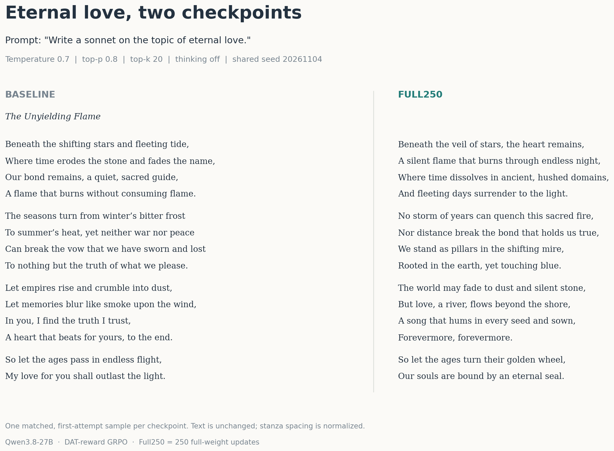
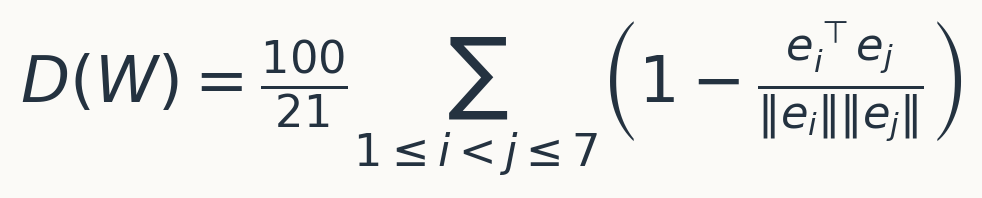
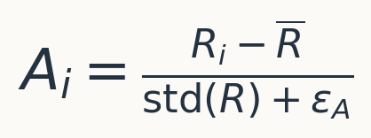
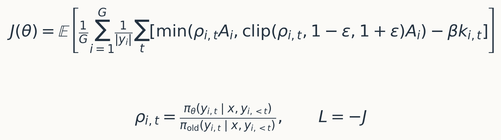
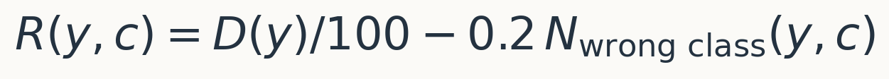
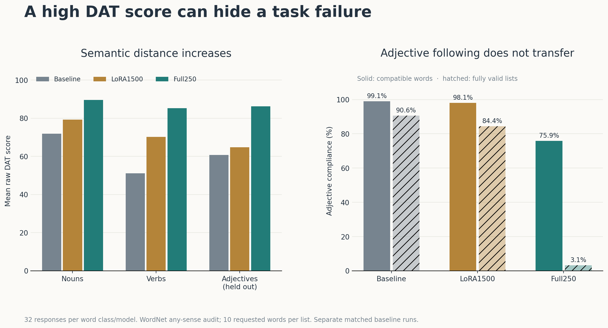
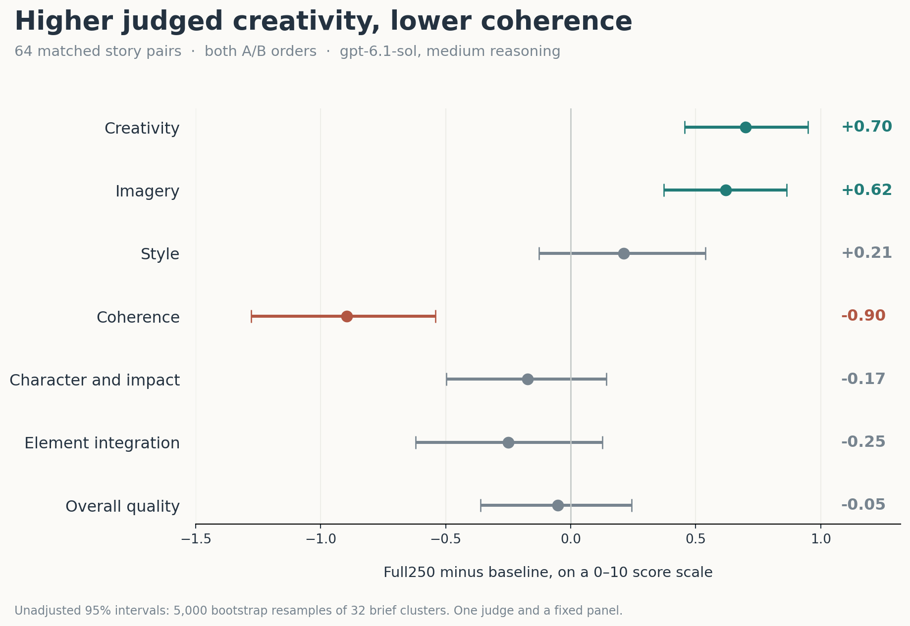

# I trained Qwen on a creativity metric and it changed its writing

**TL;DR:** I used a simple verbal-creativity metric as a reward for GRPO and
fine-tuned Qwen3.8-27B on a single NVIDIA DGX Spark. The full-weight checkpoint
became more creative and inventive in its imagery according to a paired story
evaluation, even though training contained only word lists. It also became less
coherent and worse at following some instructions. The weights are open: you
can [try the model live](https://huggingface.co/spaces/crazyleg11/full250-creativity),
[download safetensors](https://huggingface.co/crazyleg11/qwen3.8-27b-dat-grpo-full250),
or [use a GGUF quantization](https://huggingface.co/crazyleg11/qwen3.8-27b-dat-grpo-full250-GGUF).



*One first-attempt sonnet per model, with temperature 0.7, top-p 0.8, top-k 20,
thinking disabled and the same seed. These are illustrative samples; the story
panel below supplies the aggregate evidence.*

## Creativity metric

LLMs have become much better at things we can check: code, mathematics and
structured tasks. Their writing can still feel strangely narrow. I often get
polished sentences, familiar images and the same emotional resolution in a
different costume. That is a personal impression, but the concern is common
enough that YC now explicitly asks for
[“LLMs That Write Well”](https://www.ycombinator.com/rfs).

I am on a personal quest to understand whether we can change this. If we can
measure some useful part of creativity, perhaps we can reward it during
training. The difficulty is choosing a measure that improves something beyond
the measure itself.

In [my previous post](https://crazylog.substack.com/p/llms-fall-behind-humans-on-creativity),
I explored creativity tests from human psychology and applied them to LLMs.
The models in that comparison scored below the human reference on the
Divergent Association Task, or DAT. That is a result of that comparison,
rather than a claim that all LLMs must score below humans.

[DAT was developed by Jay Olson and colleagues](https://doi.org/10.1073/pnas.2022340118).
The task is wonderfully simple: produce ten nouns that are as different from
one another as possible. The score measures their average pairwise distance
in a fixed word-embedding space. Its authors describe it as a measure of verbal
divergent thinking, which is [one part of creativity](https://www.datcreativity.com/faq).
It does not directly measure whether a story is moving, coherent or worth reading.

The official implementation scores the **first seven valid, unique words**
from the ten requested, using GloVe 840B, 300-dimensional embeddings. For those
seven vectors, the score is:



There are 21 pairwise distances. The factor of 100 scales the score; it does
not make it a percentage. I used the
[original scorer](https://github.com/jayolson/divergent-association-task),
with pinned code, dictionary and embedding artifacts.

## Benchmaxxing creativity

A score gives us a reward. GRPO gives us the training loss that uses it.

For each prompt, generate a group of responses, score them, and compare each
response with the others in its group. The group-relative advantage is:



Responses above the group mean receive positive advantages; those below it
receive negative advantages. Even a positive absolute reward can have a
negative advantage. The update favors the relatively better responses, with
clipping and a penalty for drifting from the reference policy.

More formally, the [GRPO objective](https://arxiv.org/abs/2402.03300) we maximize
is a completion-length-normalized average of:



The loss is −J. Here k is the sampled KL penalty against the frozen
reference policy. I used ε = 0.1 and β = 0.04. DAT itself does
not need to be differentiable.

I will skip several failed attempts. The recipe compared here used two tasks,
**nouns and verbs**, and seven prompt wordings. Half the prompt variants added
an explicit reminder to generate only the requested word class. This produced
28 distinct prompts, balanced across a shuffled 1,120-row training dataset.
**Adjectives were held out of training.**

Distance alone is easy to optimize while ignoring the task. I therefore added
a penalty for words that did not satisfy the requested class:



The class check covers all ten words, even though DAT scores seven. Malformed
or unscoreable lists receive -2.0. Word classes come from WordNet: any noun or
verb sense counts, so an ambiguous word can satisfy both. This is a practical
lexical check, not a perfect grammatical judge.

The critical implementation is short:

```python
outcome = score_class_completion(
    response, dat_scorer, wordnet_verifier, requested_class,
    penalty_per_word=0.2, invalid_reward=-2.0,
)
reward = outcome.reward
```

The [repository](https://github.com/crazyleg/dat-grpo-creativity) contains that
scorer, a runnable example, the prompt templates and the training code.

### LoRA versus full fine-tuning

I compared two actual training runs of Qwen3.8-27B:

| Setting | LoRA1500 | Full250 |
| --- | --- | --- |
| Updated parameters | Rank-16 adapters; alpha 32 | All 26.90B text parameters |
| Policy weights | Frozen NF4 backbone with adapters | BF16 text weights |
| Optimizer | AdamW | Chunked Adafactor with FP32 statistics |
| Learning rate | 0.000001, constant | 0.000001, constant |
| Completions per prompt group | 4 | 6 |
| Optimizer updates | 1,500 | 250 |
| Sampled training completions | 6,000 | 1,500 |

The LoRA path is QLoRA because its frozen backbone is quantized to four bits.
The full path uses activation checkpointing, streamed gradients, stochastic
BF16 rounding and an NF4 reference model to fit the Spark's roughly 128 GB of
shared memory. The vision parameters remain unchanged.

Both experiments start from the same pinned NF4 backbone. For full training
and matched evaluation, it is unpacked into BF16. Thus “baseline” here means
that shared initialization, rather than an independently downloaded upstream
BF16 checkpoint.

The full run changed the writing much more visibly to me. But these runs also
differ in optimizer, group size and exposure. They compare two recipes; they
do not establish that adapters are intrinsically unable to change creativity,
or that creativity requires a particular kind of internal rewiring.

## Did it learn the task or the trick?

First, the direct DAT results. These are means over 32 responses per word
class and model, with thinking off and temperature 1.0.

| Requested class | Baseline | LoRA1500 | Full250 |
| --- | ---: | ---: | ---: |
| Nouns | 71.81 | 79.29 | 89.59 |
| Verbs | 51.11 | 70.15 | 85.21 |
| Adjectives, held out | 60.72 | 64.74 | 86.26 |

*Raw DAT score, with unscoreable responses counted as zero. The LoRA screen
used a fresh matched baseline; its adjective mean was 60.67 rather than 60.72.
The noun and verb baseline means match at the precision shown.*

Both runs learned to increase semantic distance. The adjective result looks
especially exciting until we check what the model actually generated.

| Adjective request validity | Baseline | LoRA1500 | Full250 |
| --- | ---: | ---: | ---: |
| Words with an adjective-compatible WordNet sense | 99.06% | 98.12% | 75.94% |
| Lists passing both DAT and all ten adjective checks | 29/32 | 27/32 | 1/32 |



Full250 often responded with nouns, other non-adjectives or words the lexicon
could not verify. Its raw distance score rose, but **successful adjective
transfer was not demonstrated**. The held-out task caught a failure that
distance alone hid. It also explains why raw adjective DAT would have been
a misleading checkpoint-selection criterion.

## Creativity evaluations

Training on DAT and then celebrating DAT would be benchmaxxing. The more
interesting question is whether word-list training changes a different task:
writing.

I generated 768 responses across the baseline, LoRA1500 and Full250 using
three fixed panels:

| Evaluation | Per model | Purpose | Generation settings |
| --- | ---: | --- | --- |
| [Mazur creative writing](https://github.com/lechmazur/writing) | 32 briefs × 2 samples | Stories integrating ten required elements | Temperature 1.0; top-p 1.0; top-k unrestricted |
| [WritingBench](https://github.com/X-PLUG/WritingBench) | 64 prompts | Writing quality and style | Temperature 0.7; top-p 0.8; top-k 20 |
| [SteerBench](https://github.com/MLD3/steerability) | 128 edits | Following requested style changes | Greedy decoding |

All writers used **thinking disabled**. The token caps were 2,048 for Mazur
and 4,096 for the other two panels. The sonnets at the top use the lower
temperature settings shown in their caption, rather than the Mazur settings.

The first results were mixed. WritingBench overall means were 8.06, 8.11 and
8.05 for baseline, LoRA and full tuning. There was no clear Full250 gain.
SteerBench's lower aggregate side-effect error for Full250 initially looked
encouraging, but it often made no measured style movement at all. Leaving more
of the source unchanged can lower that error without improving steering.

A local Phi4 story judge gave Full250 only 40.63% win credit. That judge also
selected the first-position story in 81.64% of all comparisons and had low
agreement after the presentation order was reversed. I did not consider that
a reliable answer to the question I cared about.

My wife and I found the full-tuned stories more unusual and often more
interesting. That was an informal, unblinded reaction, so I wanted a more
systematic comparison.

### A second judge with separate dimensions

I rescored the **64 matched baseline/Full250 story pairs** with gpt-6.1-sol,
using medium reasoning through the Codex CLI. The judge received anonymized
stories, their shared elements and a fixed seven-dimension rubric. Every pair
was presented in both A/B and B/A order, yielding 128 judgments. Earlier
judge descriptions were excluded from its inputs.

| Metric, 0–10 | Baseline | Full250 | Change | Paired 95% interval | Full250 win credit |
| --- | ---: | ---: | ---: | --- | ---: |
| Creativity | 5.22 | 5.92 | +0.70 | [+0.46, +0.95] | 74.22% |
| Imagery | 5.59 | 6.21 | +0.62 | [+0.37, +0.86] | 72.66% |
| Style | 4.64 | 4.85 | +0.21 | [-0.13, +0.54] | 56.64% |
| Coherence | 5.19 | 4.30 | -0.90 | [-1.28, -0.54] | 32.03% |
| Character and impact | 5.05 | 4.88 | -0.17 | [-0.50, +0.14] | 49.22% |
| Element integration | 5.89 | 5.64 | -0.25 | [-0.62, +0.13] | 49.22% |
| Overall quality | 5.18 | 5.13 | -0.05 | [-0.36, +0.24] | 51.95% |



Win credit assigns one point to a Full250 win, half to a tie and zero to a
baseline win, averaging both orders. For individual dimensions, score
differences below half a point count as ties; overall quality uses the judge's
explicit preference. Confidence intervals use 5,000 bootstrap resamples of the
32 briefs, keeping both samples and both orders together. They are exploratory
95% intervals, without adjustment for multiple comparisons.

**The creativity and imagery gains are clear within this protocol. So is the
coherence loss. Overall literary preference remains unresolved.**

Reading the texts helps explain that split. In one Full250 story, a failed
fireworks designer encounters the sentence, “The fall is only a rehearsal.
The rise is the lie.” His subsequent act argues with that proposition. The
ending leaves his career ruined while changing his relationship to failure:
“But he had defined the vertical.” In another, an accurate photograph threatens
a dream, and painting must transform it to preserve it. The required objects
become parts of a conceptual conflict.

Other Full250 passages lose stable referents and causal connections. Baseline
also produces substantive inventions. A more surprising association can give
a story an organizing idea, or leave it harder to follow. A single overall
score compresses those different effects.

There are two qualifications to the judge result. First, both judge and rubric
changed, so disagreement with Phi4 cannot be attributed solely to model size.
Second, 23 of the 64 baseline stories and four Full250 stories reached the
2,048-token cap. All first attempts stayed in the analysis, but this asymmetry
can affect narrative closure. A small follow-up on eight fresh briefs with a
3,072-token cap again found higher judged creativity, by 0.77 points. It is a
useful robustness check, not a replacement for a larger, calibrated evaluation.

## Overall evaluations

I also completed a conventional capability battery: 21 model/configuration
comparisons and 5,823 first-attempt responses. MMLU-Pro and GSM8K use fixed
subsets; HumanEval+ and IFEval use their full task sets.

| Benchmark | Mode | N | Baseline | LoRA1500 | Full250 |
| --- | --- | ---: | ---: | ---: | ---: |
| MMLU-Pro | No thinking | 280 | 59.29% | 59.29% | 56.07% |
| MMLU-Pro | Medium thinking | 280 | 77.86% | 77.14% | 78.57% |
| HumanEval+ | No thinking | 164 | 93.90% | 94.51% | 92.07% |
| HumanEval+ | Medium thinking | 164 | 93.29% | 93.90% | 93.90% |
| GSM8K | No thinking | 256 | 98.05% | 98.44% | 98.44% |
| GSM8K | Medium thinking | 256 | 98.44% | 98.44% | 98.05% |
| IFEval, strict prompt accuracy | No thinking | 541 | 83.18% | 80.78% | 79.48% |

Thinking modes use their separately recorded sampling settings; every
model shares the same settings within a row. These are local matched
comparisons, rather than leaderboard scores.

Math and coding stay close on these panels. Instruction following shows a
clearer regression: Full250 loses **3.70 percentage points** on IFEval, with a
paired 95% interval of [-7.21, -0.37]. LoRA loses 2.40 points. I would not
describe this as preserving all core capabilities. The adjective failure and
IFEval decline both point toward following the task being part of the cost.

## Open weights

The result I find interesting is that a cheap, external word-distance reward
changed prose the model was never directly trained to write. That change
contains a measurable increase in judged originality and inventive imagery,
alongside losses that a useful writing model needs to avoid.

My next experiment would reward creative association while explicitly
preserving instruction following and coherence, and keep a genuinely held-out
transfer task that cannot be passed by generating the wrong class of words.
Whether a better adapter recipe can achieve the same writing change is still
an open question.

You can inspect the result yourself:

- [Live Hugging Face ZeroGPU demo](https://huggingface.co/spaces/crazyleg11/full250-creativity).
- [Canonical Full250 safetensors](https://huggingface.co/crazyleg11/qwen3.8-27b-dat-grpo-full250), approximately 54.74 GB.
- [GGUF Q4_K_M and Q8_0](https://huggingface.co/crazyleg11/qwen3.8-27b-dat-grpo-full250-GGUF), approximately 16.55 GB and 28.60 GB. These passed short inference checks; the tables above evaluate the BF16 checkpoints.
- [Public code and research results](https://github.com/crazyleg/dat-grpo-creativity): training, reward implementation, prompt templates, raw generated responses, final judge outputs, protocols and figure sources.
- [Training dashboard](https://forge.coreweave.com/wandb/savsunenko-sasha/llm-creativity-grpo/runs/s1rlnaat), [paired story scores](https://forge.coreweave.com/wandb/savsunenko-sasha/llm-creativity-grpo/runs/lqteia18), and [capability results](https://forge.coreweave.com/wandb/savsunenko-sasha/llm-creativity-grpo/runs/qduhht2v).

The GGUF repository includes a tested no-thinking chat template. The live demo
defaults to the sonnet's 0.7 / 0.8 / 20 sampling settings. Try several prompts
and seeds: the question is which kinds of creative choices became more likely,
and when those choices help the writing.
