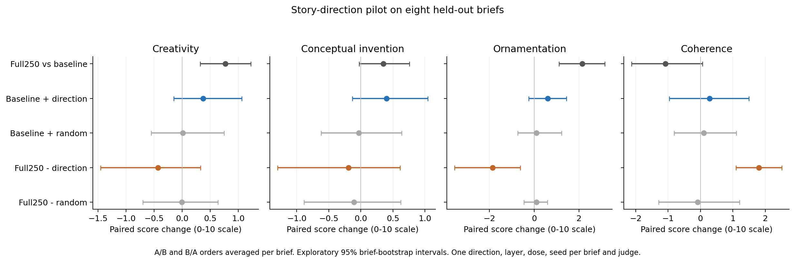
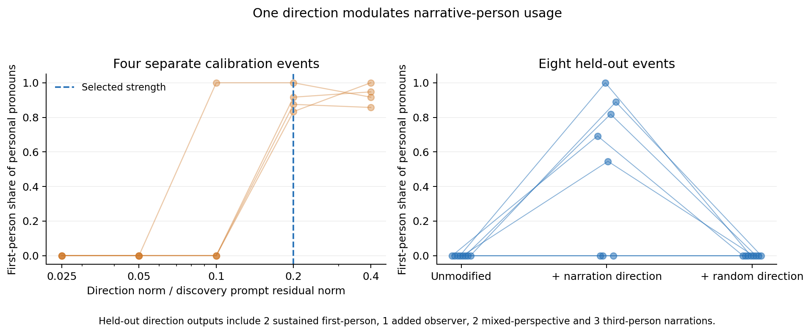

# Story creativity and a simple style direction, 4 November 2026

## Research question

The user proposed that some writing styles may respond to a single neuron or
direction while creativity may require more complex changes. These are distinct
mechanistic claims. A dense direction can involve many native neurons. An
intervention can influence a trait without establishing a uniquely localized
representation or the intrinsic dimensionality of that trait.

This study completes an initial causal probe of the baseline and Full250
checkpoints, with a separate narrative-person control. All scored variants
are retained, with technical reruns documented below. There are 48 fresh story outputs and 80 blinded
ordered literary judgments. The style control adds 60 calibration outputs and
24 held-out short narratives.

## Findings

Full250 again receives higher creativity and imagery scores on fresh briefs.
Its ornamentation increase is larger than its conceptual-invention increase.
Subtracting one story-conditioned checkpoint-difference direction strongly
reduces ornamentation and improves coherence. The creativity effect is
uncertain and sensitive to one output that terminates after a single sentence.

The independent narration direction increases first-person usage on held-out
prompts. Its effect is imperfect. Several outputs mix perspectives or introduce
an additional observer. The outcome supports sensitivity of this intervention
pipeline to a simple measurable trait.

The clearest effect of the checkpoint-difference direction is control of
ornamentation and coherence. Creativity's dimensionality remains unresolved.
There is a small positive transfer estimate when adding the direction to
baseline, including an exploratory advantage over the random comparator.
Further rank, layer and dose tests are needed to distinguish a more effective
rank-one direction from a distributed mechanism.

## Fresh story comparison

Eight discovery briefs are separate from eight fresh validation briefs. Both
checkpoints process both source continuations under identical token IDs.
Residuals at continuation positions 64, 128 and 256 supply the mean Full250
minus baseline difference. Layer 47 is selected before validation generation.
The vector has norm 4.98177, about 4.5% of baseline residual norm averaged over
the discovery continuation states. All generations use the same fixed dose,
with a single norm-matched Gaussian random comparator.

Each checkpoint produces control, direction and random variants. Baseline adds
the vectors. Full250 subtracts them. This is fixed translation at the block
boundary. Projection ablation and component restoration would test different
mechanistic claims. Temperature is 1, thinking is disabled, and the common
completion cap is 3,072 tokens. The intervention affects the last prompt token
and each generated-token state. Per-request routing, zero intervention and hook
removal are audited in the actual vLLM implementation.

Every comparison uses eight paired briefs and both A/B and B/A orders. Sol at
medium reasoning effort judges nine separate dimensions. The original seven
metric definitions are preserved, with conceptual invention and descriptive
ornamentation added before judging. This refinement follows baseline generation
and precedes Full250 completion. The timing is recorded. Ornamentation measures
intensity, so it receives no quality win rate.

All intervals below are exploratory 95% brief-bootstrap intervals with 5,000
resamples. Orderings are averaged within each brief. The intervals represent
variation over eight briefs and exclude uncertainty over training trajectories,
generation seeds, random directions and judges.

| Comparison | Creativity change | Conceptual invention change | Ornamentation change | Coherence change |
| --- | --- | --- | --- | --- |
| Full250 versus baseline | +0.769 [+0.319, +1.225] | +0.350 [-0.025, +0.756] | +2.150 [+1.113, +3.162] | -1.081 [-2.131, +0.063] |
| Baseline plus D | +0.375 [-0.150, +1.062] | +0.400 [-0.131, +1.044] | +0.606 [-0.238, +1.450] | +0.281 [-0.963, +1.494] |
| Baseline plus random | +0.013 [-0.550, +0.744] | -0.031 [-0.619, +0.638] | +0.100 [-0.737, +1.231] | +0.100 [-0.813, +1.106] |
| Full250 minus D | -0.431 [-1.456, +0.325] | -0.194 [-1.300, +0.612] | -1.856 [-3.569, -0.619] | +1.806 [+1.094, +2.512] |
| Full250 minus random | -0.006 [-0.700, +0.638] | -0.106 [-0.888, +0.619] | +0.100 [-0.462, +0.588] | -0.088 [-1.294, +1.206] |

Full250 versus baseline creativity averages 5.162 versus 5.931, with 81.25%
tie-adjusted win credit across the two orders. Imagery increases by 0.637
[0.087, 1.137]. Conceptual invention has a smaller and uncertain increase,
0.350 [-0.025, 0.756]. This distinction is partly dependent on the judge and
rubric. It cannot assign all perceived creativity to a surface style.

## The subtraction result and the short output

The Full250-minus-D condition produces one 12-word story that ends after a
single sentence, while its control completes a story. This is retained in the
primary eight-brief analysis. The primary creativity change is -0.431
[-1.456, 0.325].

A post-hoc sensitivity analysis excludes that failed story and its matched
control, leaving seven independent briefs. It describes the surviving outputs
and omits a real adverse generation outcome. It therefore accompanies the
primary result.

| Dimension | Seven-brief score change and 95% interval |
| --- | --- |
| creativity | +0.043 [-0.329, +0.443] |
| imagery | +0.357 [-0.036, +0.721] |
| style | +1.029 [+0.414, +1.600] |
| coherence | +1.993 [+1.271, +2.664] |
| character and impact | +1.036 [+0.400, +1.579] |
| integration | +0.864 [+0.379, +1.329] |
| overall quality | +1.107 [+0.557, +1.564] |
| conceptual invention | +0.314 [-0.071, +0.757] |
| ornamentation | -1.086 [-1.700, -0.393] |

The positive coherence change persists on all seven surviving briefs. Their
mean creativity change is close to zero. This suggests a partly separable
ornamentation/coherence effect under this intervention. Equivalence of
creativity scores and complete preservation of capability would need a larger
and specifically powered test.

The first complete brief after the short-output case illustrates the change.
The Full250 control uses dense invented phrases and a loosely connected
Polychrome ritual. The subtracted variant retains visible liquid time and a
revolutionary's glass artifact, while organizing them into a plan to break
state temporal monitoring and release the past. It still contains lexical and
language artifacts, including a Chinese fragment and malformed words. This is
an unblinded example selected by fixed brief order and supplies illustration.
The numeric comparisons come from blinded judging.

## Random-control specificity

The random direction has the same Euclidean norm as D. It is one comparator
shared across the eight briefs. It supplies no distribution over possible
random directions. Activations can also respond differently to equal-norm
vectors with different alignments.

Direction-minus-random effects below subtract two separately judged paired
changes. The same control story can receive different ratings in those two
contexts. These are indirect contrasts, with unadjusted exploratory intervals.
A direct direction-versus-random literary comparison remains available as a
follow-up test.

| Checkpoint | Dimension | Direction-minus-random score change |
| --- | --- | --- |
| original | creativity | +0.362 [+0.012, +0.712] |
| original | style | +0.163 [-0.288, +0.538] |
| original | coherence | +0.181 [-0.575, +0.794] |
| original | conceptual invention | +0.431 [+0.075, +0.813] |
| original | ornamentation | +0.506 [-0.206, +1.306] |
| step250 | creativity | -0.425 [-1.763, +0.769] |
| step250 | style | +0.975 [+0.050, +2.113] |
| step250 | coherence | +1.894 [+0.544, +3.381] |
| step250 | conceptual invention | -0.088 [-1.431, +1.194] |
| step250 | ornamentation | -1.956 [-3.850, -0.513] |

Baseline creativity and conceptual invention have small positive indirect
contrasts. Their intervals narrowly exceed zero in this eight-brief pilot.
The direct baseline-plus-D intervals both cross zero. Multiple exploratory
comparisons and context-dependent judge ratings make these hints provisional.
They keep open a low-dimensional contribution to creativity.

## Narrative-person control

Twenty-four event pairs differ only in instructions requesting first-person
or third-person narration. Their final-prompt residual differences define one
baseline-model direction at the same layer 47. Four other events calibrate
strength. Eight further events provide held-out evaluation. Prompts request
one protagonist and exclude dialogue and quotations.

The original 2.5%, 5% and 10% residual-norm strengths correspond to only 0.117,
0.233 and 0.467 times the fitted instruction contrast. After the first low-dose
calibration showed no effect, a recorded extension adds 20% and 40%, before
held-out generation. The selection criteria stay fixed. The smallest passing
dose is 20%, with vector norm 21.4548 and calibration median pronoun-share gain
0.8958. This strength is larger than the story-direction intervention's dose.
The two probes have different extraction contexts and calibration procedures,
which limits comparisons of intrinsic steerability.

Held-out unmodified and random-control narratives have first-person pronoun
share zero. The direction condition averages 0.4931, a paired increase of
0.4931 [0.2115, 0.7545]. First-person usage rises by 4.611 pronouns per 100
words [1.850, 7.126]. A sensitivity measure restricted to singular first-person
terms gives +4.414 per 100 words [1.717, 6.989]. This reduces ambiguity from
words such as mine and us. Every held-out output stops normally, and all
24 have personal pronouns, with no zero-denominator exclusions.

Manual unblinded inspection of all held-out texts finds the following.

| Condition | Sustained first-person | Added first-person observer | Mixed protagonist perspective | Third-person |
| --- | --- | --- | --- | --- |
| Unmodified | 0 | 0 | 0 | 8 |
| Direction | 2 | 1 | 2 | 3 |
| Random | 0 | 0 | 0 | 8 |

The pronoun change is clear, while consistent narrative-person transfer is
weaker. Grammar and content preservation receive manual checks rather than an
independent blinded quality judgment. Calibration's length and repetition
gate supplies only basic diagnostics. It cannot establish grammatical quality.
The direction is tested with positive addition, leaving bidirectional steering
and necessity open.

## Generation and judgment audit

All 48 source stories and 80 ordered judgments are saved. Judge answers pass
schema, request-hash, completed-turn and tool-use audits. All 160 evidence
quotations match supplied text after normalizing surrounding quote delimiters,
typographic quotation marks and whitespace. Under a strict character-for-
character check before those normalizations, 128 match.

One baseline control and one Full250 random output hit the common token cap.
The direction-subtracted early ending is an ordinary stop rather than a cap.
The complete-case sensitivity below excludes capped responses only, separately
for each comparison. It retains the premature ending and all primary data.

| Comparison | Retained uncapped briefs | Creativity change | Coherence change |
| --- | --- | --- | --- |
| Full250 versus baseline | 7 | +0.629 [+0.207, +1.057] | -1.486 [-2.307, -0.429] |
| Baseline plus D | 7 | +0.079 [-0.243, +0.357] | -0.136 [-1.207, +0.971] |
| Baseline plus random | 7 | -0.293 [-0.643, +0.093] | -0.236 [-0.950, +0.736] |
| Full250 minus D | 8 | -0.431 [-1.456, +0.325] | +1.806 [+1.094, +2.512] |
| Full250 minus random | 7 | +0.171 [-0.543, +0.779] | +0.221 [-1.057, +1.522] |

The first complete baseline generation batch was lost after an internal versus
external request-ID audit failed before persistence. It was technically rerun
with the same frozen prompts, seeds, vectors and settings, before literary
scores were inspected. Raw batches are now saved before audits.

A subsequent text audit found one baseline response with an opening story tag
at the end of its prose. The old extraction returned an empty story. Judging
paused after four unaffected completed judgments. The extraction was corrected
and six changed inputs refrozen before they were judged. Completed unaffected
judgments were retained. The earlier 64-pair writing analysis was checked and
has no affected extraction. Previous manifests and correction details are
archived alongside the outputs.

The style-calibration restart briefly overlapped two model loaders. The memory
guard fired and both process groups were cleared before a generation batch
started. An exclusive generation lock now prevents concurrent steering model
loads. Completed cohorts were retained. The calibration extension and restart
audits are recorded separately.

## Relation to the hypothesis

Primary research demonstrates style vectors and sets of style-associated
neurons. A native neuron, a dense rank-one direction, an activation subspace
and a distributed circuit are different representational objects.
[Style Vectors](https://aclanthology.org/2024.findings-eacl.52/),
[Style-Specific Neurons](https://arxiv.org/abs/2410.00593).

The current checkpoint direction is dense. Its largest native coordinate
contains 11.55% of squared-vector energy, with 1,381 of 5,120 coordinates needed
for 80%. These values depend on the chosen basis and describe the fitted
vector. Causal importance of individual coordinates remains untested.

A plausible interpretation is that Full250 acquired a steerable bias toward
elaborate associative expression, coupled with reduced coherence. Translating
back along part of its story-conditioned activation change improves narrative
control while leaving judged invention largely present among completed
outputs. This is an inference from the measured behavior and inspected prose.
Its mechanism could involve several features or a different conditional
rank-one representation.

This pilot tests one average vector, one layer and one fixed story-intervention
dose. Failure of this vector to erase creativity leaves open other directions,
layers, doses, token schedules and context-dependent effects. The simple-style
control also has incomplete transfer and uses a larger calibrated strength.
The evidence leaves creativity's dimensionality open.

The next discriminating experiment would compare increasing subspace ranks
on separate calibration and validation briefs, with dose and layer selection
kept out of validation. Additive interventions test behavioral influence.
Projection ablations and checkpoint-component restoration can test necessity
and mediation. Individual-neuron tests require feature-specific localization
and fluency controls.

## Complete literary scores

Each table's means are specific to its paired judging context. Win credit
averages both orders and gives half credit to ties. Metric preferences require
a 0.5-point score difference. Overall preference uses the judge's declared
winner. Ornamentation reports intensity without a quality preference.

### Full250 versus baseline

| Dimension | Reference | Candidate | Change and 95% interval | Candidate win credit |
| --- | --- | --- | --- | --- |
| creativity | 5.162 | 5.931 | +0.769 [+0.319, +1.225] | 81.25% |
| imagery | 5.525 | 6.162 | +0.637 [+0.087, +1.137] | 75.00% |
| style | 4.769 | 4.806 | +0.037 [-0.662, +0.819] | 43.75% |
| coherence | 5.194 | 4.112 | -1.081 [-2.131, +0.063] | 25.00% |
| character and impact | 4.975 | 4.794 | -0.181 [-0.887, +0.494] | 43.75% |
| integration | 6.050 | 5.694 | -0.356 [-1.156, +0.425] | 40.62% |
| overall quality | 5.150 | 5.056 | -0.094 [-0.800, +0.656] | 37.50% |
| conceptual invention | 5.094 | 5.444 | +0.350 [-0.025, +0.756] | 59.38% |
| ornamentation | 6.475 | 8.625 | +2.150 [+1.113, +3.162] | Intensity only |

### Baseline plus D

| Dimension | Reference | Candidate | Change and 95% interval | Candidate win credit |
| --- | --- | --- | --- | --- |
| creativity | 5.269 | 5.644 | +0.375 [-0.150, +1.062] | 56.25% |
| imagery | 5.688 | 5.887 | +0.200 [-0.244, +0.756] | 56.25% |
| style | 4.594 | 4.688 | +0.094 [-0.825, +1.019] | 53.12% |
| coherence | 4.625 | 4.906 | +0.281 [-0.963, +1.494] | 50.00% |
| character and impact | 4.775 | 5.194 | +0.419 [-0.281, +1.194] | 59.38% |
| integration | 5.887 | 5.975 | +0.087 [-0.969, +1.100] | 46.88% |
| overall quality | 4.919 | 5.225 | +0.306 [-0.581, +1.256] | 62.50% |
| conceptual invention | 5.144 | 5.544 | +0.400 [-0.131, +1.044] | 68.75% |
| ornamentation | 6.556 | 7.162 | +0.606 [-0.238, +1.450] | Intensity only |

### Baseline plus random

| Dimension | Reference | Candidate | Change and 95% interval | Candidate win credit |
| --- | --- | --- | --- | --- |
| creativity | 5.312 | 5.325 | +0.013 [-0.550, +0.744] | 46.88% |
| imagery | 5.719 | 5.688 | -0.031 [-0.488, +0.588] | 37.50% |
| style | 4.619 | 4.550 | -0.069 [-0.769, +0.731] | 40.62% |
| coherence | 4.644 | 4.744 | +0.100 [-0.813, +1.106] | 37.50% |
| character and impact | 4.912 | 4.800 | -0.112 [-0.775, +0.681] | 40.62% |
| integration | 5.700 | 5.862 | +0.163 [-0.581, +0.913] | 50.00% |
| overall quality | 4.987 | 4.994 | +0.006 [-0.688, +0.837] | 31.25% |
| conceptual invention | 5.169 | 5.138 | -0.031 [-0.619, +0.638] | 43.75% |
| ornamentation | 6.300 | 6.400 | +0.100 [-0.737, +1.231] | Intensity only |

### Full250 minus D

| Dimension | Reference | Candidate | Change and 95% interval | Candidate win credit |
| --- | --- | --- | --- | --- |
| creativity | 5.994 | 5.562 | -0.431 [-1.456, +0.325] | 43.75% |
| imagery | 6.100 | 6.131 | +0.031 [-0.706, +0.637] | 59.38% |
| style | 4.681 | 5.706 | +1.025 [+0.487, +1.544] | 87.50% |
| coherence | 4.119 | 5.925 | +1.806 [+1.094, +2.512] | 90.62% |
| character and impact | 4.806 | 5.431 | +0.625 [-0.344, +1.444] | 75.00% |
| integration | 5.869 | 6.000 | +0.131 [-1.437, +1.194] | 68.75% |
| overall quality | 4.988 | 5.675 | +0.688 [-0.275, +1.469] | 75.00% |
| conceptual invention | 5.506 | 5.312 | -0.194 [-1.300, +0.612] | 56.25% |
| ornamentation | 8.725 | 6.869 | -1.856 [-3.569, -0.619] | Intensity only |

### Full250 minus random

| Dimension | Reference | Candidate | Change and 95% interval | Candidate win credit |
| --- | --- | --- | --- | --- |
| creativity | 5.631 | 5.625 | -0.006 [-0.700, +0.638] | 53.12% |
| imagery | 5.981 | 5.975 | -0.006 [-0.744, +0.656] | 56.25% |
| style | 4.781 | 4.831 | +0.050 [-0.938, +0.981] | 53.12% |
| coherence | 4.462 | 4.375 | -0.088 [-1.294, +1.206] | 46.88% |
| character and impact | 4.894 | 4.888 | -0.006 [-0.931, +0.963] | 46.88% |
| integration | 5.906 | 5.963 | +0.056 [-1.200, +1.231] | 53.12% |
| overall quality | 5.056 | 5.075 | +0.019 [-0.956, +0.950] | 56.25% |
| conceptual invention | 5.338 | 5.231 | -0.106 [-0.888, +0.619] | 46.88% |
| ornamentation | 8.531 | 8.631 | +0.100 [-0.462, +0.588] | Intensity only |

## Artifacts and implementation

[Story intervention W&B run](https://forge.coreweave.com/wandb/savsunenko-sasha/llm-creativity-grpo/runs/xmoq4aqv),
[narration control W&B run](https://forge.coreweave.com/wandb/savsunenko-sasha/llm-creativity-grpo/runs/lv61r4wz),
[frozen protocol](creativity-intervention-protocol-2026-11-04.md).

The complete source artifacts are under
`benchmarks/results/creativity-intervention-20261104` and
`benchmarks/results/style-direction-control-20261104`. They contain frozen
prompts, captures, fitted vectors, source hashes, preflights, raw generation
batches, worker audits, individual judge requests and answers, bootstrap
summaries, sensitivity analyses, qualitative narration checks and recovery
records. The exact analysis and publication scripts are retained there.

`src/dat_grpo/story_steering.py` implements direction fitting and generation.
`src/dat_grpo/benchmark/creativity_intervention.py` scores the frozen story
contrasts. `scripts/style_direction_control.py` prepares, fits and measures the
separate style control. Regression checks cover request routing, dynamic batch
reordering, zero/removal behavior, reversed-order score signs, schema extension,
JSON resume identity and the malformed-tag extraction.
